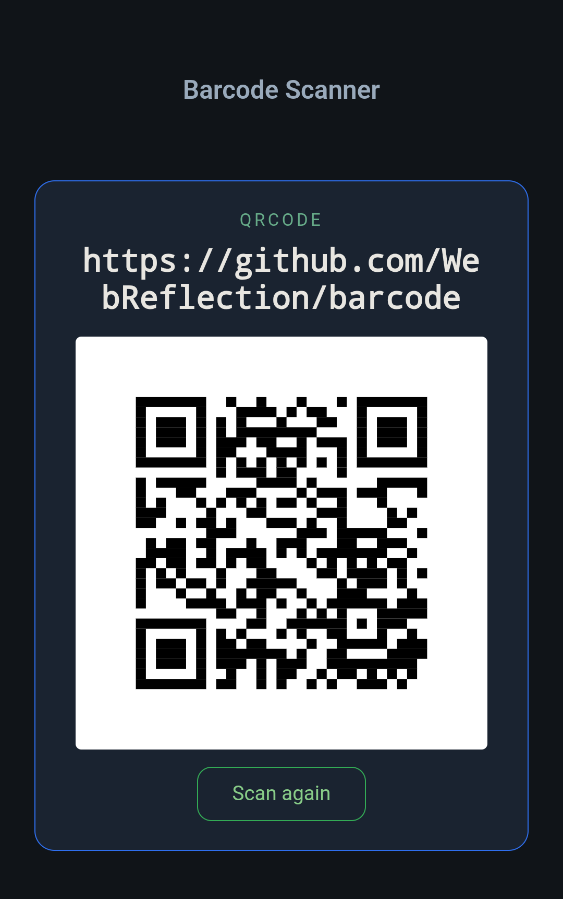

# barcode

<sup>**Social Media Photo by [Risto Kokkonen](https://unsplash.com/@risto_kokkonen) on [Unsplash](https://unsplash.com/)**</sup>

MIT-licensed, WebGPU-accelerated barcode and QR scanning for the web. The
decoder core is clean-room Rust compiled to WebAssembly (the same core is
meant to grow native Android/iOS bindings later).

**Clean-room decoders**: no ZXing, no ZBar, no zint source. Everything is
implemented from the public ISO/GS1 specifications, so the whole tree is MIT
with no attribution baggage. zxing/zint are used only as black-box oracles
while developing.

**[Live demos →](https://webreflection.github.io/barcode/)** — camera scan,
still-image scan, render playground, worker API, bring-your-own video,
one click each.



## Formats

Decoded from a live camera or a still image, one code per frame — 19
canonical symbologies (EAN-13 and UPC-A are separate names sharing one
decoder):

| 1D | 2D |
| --- | --- |
| EAN-13 / UPC-A | QR (v1–40, all EC levels and masks, ECI, rotation/perspective) |
| EAN-8 | Micro QR (M1–M4, roll-aware sampling) |
| UPC-E | Data Matrix (ECC200, square and rectangular/DMRE) |
| Code 39 | Aztec (compact and full) |
| Code 32 (Italian Pharmacode) | PDF417 |
| Code 93 | |
| Code 128 / GS1-128 (FNC1) | |
| ITF / Interleaved 2 of 5 | |
| Codabar | |
| GS1 DataBar (Omni, Limited, Stacked, Stacked Omni) | |
| GS1 DataBar Expanded | |

Inverted (white-on-black) codes are read on both paths: a code filling a
dark scene, and a white-on-black code sitting on a **light** page (a
screenshot or a photographed label with white margins).

`render()` re-encodes a result as SVG for **all 19** symbologies, with QR
v1–40 (explicit error-correction level / mask / version), Micro QR, Data
Matrix (including explicit rectangular sizes), Aztec and PDF417 (explicit
EC level). See `packages/web/README.md` for the options.

## Usage

```sh
pnpm add @webreflection/barcode
```

Two entries, one package: `@webreflection/barcode/main` for the page
(`barcode()` → `{ scan, render, worker }`) and
`@webreflection/barcode/worker` for a worker (the bootstrap promise).
There is **no bare package entry**: an entry that guessed the context
would have to import the worker lazily, and a lazily imported worker
cannot guarantee the MessagePort channel.

```js
import barcode from "@webreflection/barcode/main";
import "@webreflection/barcode/css"; // optional: the default scan dialog

// One session per page/SPA: it owns the worker for its lifetime.
const { scan, render } = barcode();

// Live scan: no arguments opens the built-in dialog (camera, torch, ✕).
// Pass { into } / { video } to mount it yourself, or { image } for a still.
const code = await scan({ accuracy: "auto", type: ["qr", "code128"] });
if (code) {
  console.log(code.symbology, code.text);
  const svg = await render(code); // styleable via --barcode-ink/--barcode-paper
  document.body.append(svg);
}
```

```js
// your worker — static at the top of the file, never awaited
import bootstrap from "@webreflection/barcode/worker";
const { decode, encode } = await bootstrap;
```

`scan({ image })` takes a canvas, `ImageBitmap`, `HTMLImageElement`, `SVG`,
`Blob`/`File` or `OffscreenCanvas`; `scan()` takes the camera. Either way it
resolves **once** with the best `Code` (most centered first) or `undefined`
(abort via `signal`, or the latency budget expired) and never throws for a
graceful stop. Only one scan runs at a time per session.

## Publish contract

The npm package is `README.md`, `LICENSE` and one `dist/` folder; there is
no bundler step for consumers:

| file | role |
| --- | --- |
| `dist/main.js` | page entry: `barcode()` → `{ scan, render, worker }` |
| `dist/worker.js` | worker entry: binarizer + wasm decode/encode |
| `dist/wasm.wasm` | the Rust decoder core (fetched by `worker.js` relative to itself) |
| `dist/css.css` | optional default dialog styles (CSS custom properties) |
| `dist/*.d.ts` | consumer types for the two entries |

`main.js` spawns `./worker.js`, and `worker.js` fetches `wasm.wasm`;
both resolve relative to the file that owns them, so plain static
hosting, import maps and CDNs all work **when the files stay side by
side**. A CDN worker needs the one-line same-origin shim below (a
`Worker` script cannot be cross-origin). The whole build — types, wasm,
artifacts, and the docs site — is one command at the repo root:

```sh
npm run build              # → packages/web/dist (npm payload)
npm run build:demo         # → packages/web/demo-dist (deployable demo)
```

The worker contract is **one message**: the page posts the MessagePort
as the worker's *first* message; the worker captures it, removes the
listener, and binds exactly once. There is no ping/ready round-trip, no
retry and no timeout. The worker entry must import the SDK statically at
the top of its file, so the capture listener exists before the port can
be dispatched. Port-less messages pass through untouched, so an embedder
keeps its own protocol on the same worker.

### Loading from a CDN without a bundler

`new Worker(url)` only accepts a **same-origin** script, so a page that
imports `main.js` from a CDN must spawn a one-line same-origin shim:

```js
// worker-shim.js — same origin, one line
import "https://cdn.jsdelivr.net/npm/@webreflection/barcode@0.2.5/dist/worker.js";
```

```js
import barcode from "https://cdn.jsdelivr.net/npm/@webreflection/barcode@0.2.5/dist/main.js";

const { scan, render } = barcode({ worker: "./worker-shim.js" });
```

That is exactly how the live playground loads itself: the committed
`docs/` pins the published version and ships the one-line shim, so the
demos exercise the npm artifact rather than a second build.

## Architecture

```
MediaStream → VideoFrame ──→ GPU (WGSL compute): downscale → luma → box mean → Bradley binarize
                                  │
                                  ▼  1-bit mask readback (~115 KB @ 720p)
                             Rust/WASM decoders → DecodeResult { text, symbology, quad }
```

The GPU does what GPUs are good at (bulk pixel work); the branchy,
data-dependent decode runs in WASM on a tiny 1-bit mask. The only GPU→CPU
transfer per frame is the packed mask. Every 2D family converges on one
shared rectifier (`barcode_core::geometry`: homography fit/apply, module-grid
sampling), so rotation, shear and perspective are one correction rather than
one per symbology; Reed–Solomon correction is erasure-aware for QR, PDF417,
Data Matrix and Aztec.

- `crates/barcode-core` — `BitImage` (1bpp layout), `SymbologyDecoder`
  contract, shared geometry/rectification, RS helpers.
- `crates/barcode-{qr,microqr,dm,aztec,pdf417,ean13,ean8,upce,code39,code93,code128,itf,codabar,databar}`
  — one decoder per family (plus encoders where `render()` supports it).
- `crates/barcode-wasm` — the wasm bridge: tier scheduling, format lists,
  encode/decode exports.
- `packages/web/src/gpu/binarizer.js` + `src/shaders/*.wgsl` — WGSL pipeline
  and mask readback.
- `packages/web/src/camera.js` — lens enumeration/selection, zoom, torch.
- `packages/web/src/scanner.js` — frame pump (`requestVideoFrameCallback`),
  adaptive zoom, close-up hint crop, result ranking.
- `packages/web/src/roi.js` — native-resolution crops for codes that are
  small in the frame.
- `packages/web/api/main.js` / `api/worker.js` — the published API and the
  worker protocol.

## Field results

Real phone photos, replayed through the published bundle (`still` =
`scan({ image })`, `live` = the same photo through a fake camera +
`scan({ video })`). The personal corpus currently has **30 still photos
and 17 live replays**; the latest still run is **30/30** and the live run
is **16/17**, with one tracked xfail: `viva-dm-115212` is a ~2px/module
Data Matrix in a full 12MP frame, below what the 1056px live frame can
resolve (the still pass and the center-square crop both read it). The
corpus covers product EAN-13/UPC/EAN-8, ISBN, a shipping-slip ITF, a
vertical invoice Code 128, loyalty cards, receipt QRs, DataMatrix (square
and DMRE), VIVA QR, and 12 Lufthansa/DB Bahn Aztec boarding passes.

Live reads on the phone are typically a few hundred milliseconds; the
still corpus is bounded by the still budget. The previously tracked
full-frame Data Matrix (`viva-dm-115212-centered`) now passes through the
native-resolution ROI pass.

Personal fixtures stay local: `packages/web/test-codes/field/` (photos +
`corpus.json`) is gitignored. The gate *skips* when it is absent.

## Demo

```sh
cd packages/web && pnpm install && pnpm dev   # http://localhost:5173
```

Node 24+ is required (CI tracks the latest LTS via `lts/*`).

Open `/` for the playground index, or `/scan.html` — the public-API demo:
one `barcode()` session, one worker, `scan()` then `render()`; its default
is everything. The other public pages are `/live.html`, `/still.html`,
`/render.html` and `/worker.html`.

The internal harness (self-test, contract, artifact, diagnostics, fake
camera) lives in `tests/`, outside the dev server root. The dev server
serves it through `/@fs/...`; the CDP tools default to those URLs
(`node tools/run-tests.mjs` opens `tests/test.html`).

To build a demo that deploys anywhere (a static folder, relative URLs, one
shared wasm — no bundler at serve time):

```sh
npm run build:demo      # → packages/web/demo-dist/scan.html + assets/
npm run serve:demo      # http://<lan-ip>:8124
npm run serve:iphone    # https://<lan-ip>:8443 (mkcert + trust notes)
```

The public site in `docs/` is the same thing plus a landing page and one
demo per API surface:

```sh
npm run build:docs      # → docs/ (index, scan, live, still, render, worker)
npm run serve:docs      # http://<lan-ip>:8128
npm run serve:docs:iphone  # https on :8443 for a real iPhone
```

The committed `docs/` loads the exact published version from jsDelivr with
the one-line same-origin worker shim above, so the deployed demos exercise
the npm artifact rather than a second build.

GitHub Pages serves the committed `docs/` folder: Settings → Pages →
Deploy from a branch → `main` / `/docs` (the built-in
`pages-build-deployment` run).

The iPhone needs a secure origin for the camera; `serve:iphone` generates
a LAN certificate with `mkcert` and prints the one-time CA trust steps.
The automated `iphone` Playwright project (WebKit + iPhone descriptor)
covers the same UI and fake-camera suite in CI without a device.

The built page passes the whole fake-camera e2e suite on the phone
(`E2E_ORIGIN=http://localhost:8124 node tools/e2e/fakecam.mjs --all
--port 9226`), including the inverted, diagonal and tiny-in-frame cases. Phone over USB, no HTTPS needed —
`adb reverse` makes the dev server `localhost`:

```sh
adb reverse tcp:5173 tcp:5173
adb forward tcp:9222 localabstract:chrome_devtools_remote
node packages/web/tools/drive.mjs /tmp/barcode-phone.jpg
```

The driver grants camera permission over CDP (the token is `videoCapture`
on Android), clicks start, and streams stats/screenshots. Chrome also needs
the OS-level camera permission:
`adb shell pm grant com.android.chrome android.permission.CAMERA`.

## Gates

CI runs the page suites with Playwright (the fake-camera mock needs no
physical device). Per push/PR the gate is **Chromium only** (a couple of
minutes); WebKit/Safari-engine runs nightly and on manual dispatch. A
native `cargo test --workspace --locked` job (plus
`cargo check --workspace --examples --locked`) runs alongside it.

```sh
npm test                          # chromium + webkit + iphone profile
npm run test:ci                   # headless chromium + webkit
npm run test:ci:chromium          # what CI runs per push
npm run test:ci:webkit            # Safari engine (nightly / manual)
```

The CDP tools remain the authority for real phones:

```sh
cargo test --workspace
cd packages/web
node tools/run-tests.mjs 9222                          # tests/test.html
node tools/run-tests.mjs 9222 "http://localhost:5173/@fs$PWD/tests/test.html?bin=cpu"
node tools/run-contract.mjs 9222                       # tests/contract-test.html
node tools/e2e/fakecam.mjs --all --port 9222           # Android, adb forward 9222
node tools/e2e/field.mjs --port 9222 [--mode live]     # real photos, local corpus
```

`npm run test:phone` / `test:field` are shortcuts for the Android and
real-photo gates.

`tests/roi.html`, `tests/diagonal.html`, `tests/tilt.html` and
`tests/harden.html` use the same `run-tests.mjs` driver with their own URL
(e.g. `.../@fs$PWD/tests/roi.html`). The fake-camera e2e accepts
`E2E_ORIGIN` to run against a built demo instead of the dev server.

`tests/test.html` is the synthetic round-trip harness (decode + SVG
round-trip), `tests/roi.html` covers small codes in a 4096 px frame,
`tests/diagonal.html` covers 45°/135° rotation, `tests/tilt.html` covers
±4°/8° roll and `tests/harden.html` the synthetic blur/noise/defocus sweep.

## Known limits / next

- One code per scan (by design for now); multi-code scanning is future work.
- `databarexpanded` rendering picks the compressed encodation whenever the
  element string matches one of the standard's AI-(01) families (AI 01 +
  general purpose, `310x`/`320x` weight, `392x`/`393x` price, `310x`/`320x`
  + date); any other element string falls back to the general-purpose
  (method 00) field, which is valid for all AIs but longer.
- GPU contrast normalization (per-tile stretch) for dim/grey captures is not
  done yet.
- Native Android/iOS bindings on top of the same Rust core.


## License

MIT — see [LICENSE](LICENSE).
